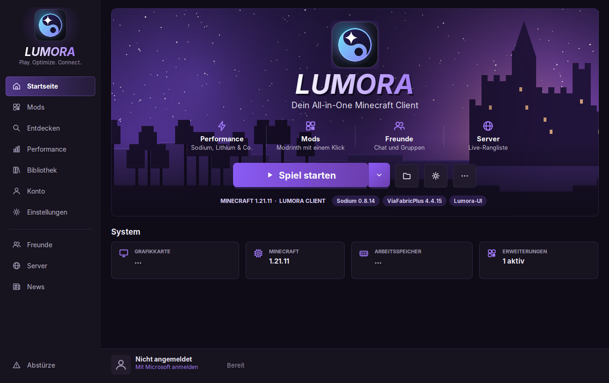

# Lumora Client

Eigenständige Minecraft-Client-Distribution für **Minecraft: Java Edition 1.8.9 bis 26.3** (18 Versionen) mit
eigenem Windows-Launcher (`LumoraLauncher.exe`), eigenem **Lumora Loader** (Minecraft ohne Mod-Loader, nur Vanilla
plus Lumora-Addons), der Lumora-Oberfläche (Hauptmenü, Hub, HUD-Editor, Widgets,
Zoom, Schlaganimation) und **Lumora Social** (Freunde, Gruppen mit Rollen, Chat) in jeder Version.
Java und Minecraft muss niemand selbst installieren: Launcher öffnen, anmelden, „Spielen“.




## Was steckt drin

| Bereich | Umsetzung |
|---|---|
| Launcher | Native Windows-EXE (jpackage) mit eigener Java-Runtime und Startbildschirm. **Selbst-Update** über GitHub Releases (nur mit gültiger Ed25519-Signatur und SHA-256). **Startseite** mit großem Logo, Funktionsleiste und „Spiel starten“; der Pfeil daneben öffnet die **Versionsauswahl** (Startart und eine Kachel je Hauptversion mit eigener Pixel-Art oder deinem neuesten Screenshot, Unterversionen als Chips, Spielzeit, Dateien prüfen), Seitenleiste mit Zählern für Freunde und News, **Blaues Design** mit fließenden Effekten (Polarlicht im Startbanner, fließender Start-Knopf mit Lichtstreifen, gleitende Auswahl in der Seitenleiste, leuchtende Karten unter der Maus, weiche Seitenübergänge; „Weniger Bewegung“ schaltet alles ab), Akzentfarbe wählbar. **Startarten** Lumora Client und Vanilla (eigener Spielordner). Wählbare Mod-Loader sind vorerst entfernt. Updates, Diagnose, Logs |
| Performance | Grafik-Profile (Maximale FPS, Ausgewogen, Beste Grafik) für die `options.txt` der Version mit Sicherung und Wiederherstellen, Performance-Mods der Version, optimierter Garbage Collector, empfohlener Arbeitsspeicher, letzter Benchmark |
| Neuigkeiten | News und Changelog, Filter Alle/Lumora/Minecraft: Lumora-News (mitgeliefert) und Minecraft: Java Edition News und Patch Notes aus Mojangs Launcher-Inhalten (`launchercontent.mojang.com`, wie im offiziellen Launcher), offline aus dem Cache |
| Server | Beliebte Server und eigene Server, sortiert nach Spielern online: Spielerzahl, Server-Icon und Version **live vom Server** (Server List Ping), Verlauf (24 Std.) und Wochentrend aus eigenen Messungen, eigene Sterne-Bewertung, Suche, Filter nach Modus und Sprache, Beitreten per Quick Play |
| Einstellungen | Kategorien (Allgemein, Erscheinungsbild, Spiel, Speicher, Freunde & Chat, Integrationen, Fehlersuche), Suche, erweiterter Modus, sofortiges Speichern; u. a. Spielverzeichnis, **Mit Windows starten**, **Im Tray bleiben**, gleichzeitige Downloads, Startseite, Akzentfarbe, Pixel-Stil, Reduziere Bewegungen, Hardwarebeschleunigung, Mehrere Instanzen, Aktion nach dem Start, Arbeitsspeicher, Fensterauflösung, Vollbild erzwingen, JVM-Argumente, Umgebungsvariablen, eigene JRE, **Speicherübersicht** (Belegung je Kategorie, Leeren, „Ungenutzte Daten löschen“), Lumora-Social-Server, Ungelesen-Zähler, Benachrichtigungen, **Discord Rich Presence**, Heap-Dump, Debug-Modus |
| Bibliothek | Je Version: Welten (Name, Icon, Spielmodus, zuletzt gespielt) mit „Spielen“ (startet direkt in die Welt) und „Backup“ (ZIP), Server aus der Mehrspielerliste mit Live-Status (Spieler, Ping, Version, Server-Icon) und „Beitreten“ (Minecraft Quick Play), Screenshot-Galerie, Ressourcenpakete |
| Abstürze | Crash-Reports aller Versionen mit Beschreibung, Ausnahme, **wahrscheinlicher Ursache** (Stacktrace, Mixin-Konfigurationen, Addons), Lösungshinweisen und Aktionen: Reparieren, neu starten, anonymisiert kopieren, Diagnosepaket (ZIP). Nach einem Absturz öffnet sich automatisch eine Zusammenfassung |
| Installation | Offizielle Quellen: Mojang (Spiel, Assets, Java, Namensliste `client_mappings`), Modrinth (Ressourcenpakete). Gestartet wird über den eigenen Lumora Loader, kein Fabric. **Jede Datei per SHA-1/SHA-512 geprüft**, Retry, Reparaturmodus |
| Anmeldung | Offizieller Microsoft-Device-Code-Flow → Xbox Live → XSTS → Minecraft Services, Lizenzprüfung. Sitzung DPAPI-verschlüsselt, Tokens nie in Logs |
| Versionen | Ein Profil pro Minecraft-Version: **26.3, 26.2, 26.1.2** (Standard), **26.1.1, 26.1, 1.21.11, 1.21.8, 1.21.4, 1.21, 1.20.6, 1.20.4, 1.20.1, 1.19.4, 1.18.2, 1.17.1, 1.16.5, 1.12.2, 1.8.9** – jeweils mit eigenem Spielordner und eigener Lumora-Client-Portierung, siehe [COMPATIBILITY.md](docs/COMPATIBILITY.md) |
| Vor dem Start | Prüfung aller Mods auf `depends`/`breaks`, auch in Jar-in-Jar, mit verständlicher Fehlermeldung statt Absturz |
| Im Spiel | Alles im **Lila-Design des Launchers** (Hub, Hauptmenü mit Schloss-Hintergrund, Lumora Theme für die Minecraft-Menüs, HUD-Editor, Ladebildschirm). **Lumora-Module** (je eigener Schalter im Hub unter Addons): Fadenkreuz-Editor, Toggle Sprint/Sneak, Fullbright, Chat mit Zeitstempeln und gestapelten Nachrichten, Tab-Liste mit Ping in ms, Scoreboard verschieben/skalieren/ausblenden, Info-Widgets (Effekte, Pfeile & Items, Kompass, Speicher, Tag, Ressourcenpakete, Combo), Block-Overlay nach FDPClient und BThack (Box, nur Füllung oder nur Umrandung mit eigenen Farben, Regenbogen, Dicke, nur die angesehene Seite, Gleiten zwischen Blöcken mit Linear/Quad/Expo, Einblenden, Blockinfo), Button-Designs (Blackout, Hyperium, Liquid, Lunar, PvPClient, Rounded), **eigene Server- und Weltliste** (Kontokarte, Suche, „Nur online“, Versionsfilter, Serverkarten mit Favicon, MOTD, Spielern, Version und Ping, Hinzufügen/Bearbeiten/Sortieren/Direkt verbinden, Weltkarten mit Modus und Version; „Klassisch“ öffnet das Vanilla-Menü). **Verbindungssystem** nach dem Vorbild von LiquidBounce (eigene Umsetzung): Verbindungsbildschirm mit allen Phasen und ihrer Dauer (Verbinden, Login, Kontoprüfung bei Mojang, Verschlüsselung, Konfiguration, Welt laden), Live-Ping mit Spielern, Version und MOTD, Weg „Du ⟷ aufgelöste Adresse ⟷ Server“; Trennungsbildschirm mit erkanntem Grund (Zeitüberschreitung, nicht erreichbar, gesperrt, Whitelist, voll, falsche Version, Kontoproblem …) und Tipp, „Erneut verbinden“, **automatisches Neuverbinden** mit wachsenden Pausen (nie bei Sperren, Whitelist, Versions- oder Kontofehlern), Abbruch hängender Phasen, Stream-Modus ohne Adressen. Login, Verschlüsselung und Sitzung macht weiterhin Minecraft selbst. **Mod-Hub** (Rechte Umschalttaste, Hauptmenü, ESC-Menü) mit Tabs Module / Einstellungen / Zoom / Addons / System. **Zoom** (Taste C, 2–10×, Mausrad bis 50×, Halten/Umschalten, weich, langsamere Maus, filmische Kamera, dunkler Rand). **HUD** mit FPS, CPS, Koordinaten + Blickrichtung, Tastenanzeige, Ping, Uhrzeit, Tempo, Rüstung, Server und **HUD-Editor** für alle Widgets, auch aus Addons (Auswahl, Ziehen mit Einrasten und Raster, Eckgriffe, Ebenen, Ein-/Ausblenden, Optionen je Widget, Rückgängig, Profile Standard/PvP/Survival/Minimal/eigene). Einstellbare **Menü-Übergänge** (Überblenden/Gleiten, Dauer, auch Spiel ↔ Menü), **Lumora-Ladebildschirm**, optionale **Lumora-Schrift** (Inter), Schlaganimation (Vanilla/Smooth/Spin/Slap, aus LiquidBounce), F9-Benchmark, Diagnose |
| Freunde & Chat | **Lumora Social** im Launcher (Seite „Freunde“) und im Spiel (Taste U, „☻ Freunde“ im Haupt- und ESC-Menü): Freunde mit Live-Status (Launcher, Hauptmenü, Einzelspieler, „Auf mc.server.de“), Anfragen, Gruppen mit Banner, Beschreibung und eigenen Rollen (Symbol, Farbe, Verwalten-Recht), Direkt- und Gruppenchat mit Ungelesen-Zählern und ✓✓-Lesebestätigung, Benachrichtigungen im Spiel, „Server beitreten“. Anmeldung über den offiziellen Mojang-Sitzungsdienst (kein Passwort, kein Token an den Server). Eigener, selbst gehosteter Server (`lumora-social-server.jar`), siehe [SOCIAL.md](docs/SOCIAL.md) |
| Addon-API | **Lumora-API 1.2** für eigene Erweiterungen (neu: Verbindungs-Events): Addons mit **eigenem Addon-Loader**: eine JAR mit `lumora-addon.json` in den Ordner `addons` der Instanz legen. Kein Mod-Loader nötig, jede JAR hat einen eigenen Class-Loader, Fehler stehen mit Grund in der Addon-Liste, im Hub gibt es den Knopf „Addon-Ordner“. Dazu Abhängigkeiten, Berechtigungen, Lebenszyklus mit automatischem Aufräumen), HUD-Widgets, Event-Bus, typisierte Einstellungen mit erzeugten Menüs, Laufzeit-Tastenbelegungen, Benachrichtigungen, Aufgaben, Spielinfos. Beispiel-Addon „Session Timer“ (eine JAR für alle Versionen), LabyVoice als erstes echtes Addon. Siehe [API_REFERENCE.md](docs/API_REFERENCE.md) |
| Ressourcenpakete | Better Leaves, Dramatic Skys, Enhanced Audio, Even Better Enchants, Fresh Animations, Fresh Food, Icons, Enhanced Boss Bars – je Version passend von Modrinth, SHA-512 geprüft, im Spiel aktiviert. Pakete, die eine Mod bräuchten, sind entfernt |
| Entdecken | Ressourcenpakete der gewählten Version auf Modrinth suchen und installieren (SHA-512), Filter für Kategorien |
| Konto | **Skin hochladen** (Vorschau, Steve/Alex), Standard-Skin, **Umhang wählen**, Skin-Bibliothek. Account-Manager (mehrere Microsoft-Konten, wechseln, entfernen; jedes einzeln DPAPI-verschlüsselt) und **3D-Skin-Vorschau** (drehbar, zweite Skin-Ebene, Skins anderer Spieler per Name) |
| Leistung | Verlauf der F9-Benchmarks je Version als Diagramm (Ø-FPS, 1 %-Lows) in der Bibliothek |
| Qualität | 341 automatisierte Tests (davon 43 für die Lumora-API und 9 für Lumora Social mit echtem Server), Integrationstest mit den echten Mod-JARs aller Versionen, Smoke-Test aller 18 Versionen auf echter GPU inklusive Demo-Welt (Nachweise in `docs/test-evidence/`) |

## Schnellstart (Nutzer)

1. **`LumoraClient.exe`** doppelklicken (eine Datei, keine Installation; der erste Start entpackt sich einmalig).
   Alternativ: ZIP entpacken und `LumoraLauncher.exe` starten oder `LumoraClient-Setup-<version>.exe` ausführen.
2. Im Launcher auf **Spielen** klicken.
3. Beim ersten Mal: Downloads abwarten, Code auf microsoft.com/link eingeben.

Voraussetzungen: Windows 10/11 64 Bit, gekaufte Minecraft: Java Edition. Für die Anmeldung muss der Verteiler eine
**von Mojang freigeschaltete Azure-Client-ID** hinterlegen ([BUILD.md](docs/BUILD.md#microsoft-anmeldung-einrichten-einmalig-für-verteiler)).

## Schnellstart (Entwickler)

```bat
gradlew.bat build
gradlew.bat :launcher-app:run
gradlew.bat :launcher-app:releaseDist
```

## Projektstruktur

```
lumora-client/
├── launcher-core/        versionsunabhängige Launcher-Logik (+ profiles.json-Lockfile)
├── launcher-app/         Swing-GUI, CLI, jpackage/Release-Tasks
├── lumora-api/           öffentliche Client-API für Addons und Widgets (Java 21, ohne Minecraft-Klassen)
├── lumora-core/          Implementierung: Addon-Manager, Event-Bus, Widget-Registry, HUD-Layouts, Editor-Logik, Social-Ansicht im Spiel
├── lumora-social/        Lumora Social: Protokoll, Datenmodell, Client (Launcher und Mod), Mojang-Sitzungsnachweis
├── lumora-social-server/ selbst hostbarer Server für Freunde, Gruppen und Chat (eine JAR)
├── lumora-loader/        Lumora Loader: startet Minecraft ohne Mod-Loader (Klassenlader, Mixin, Umbenennen der Spiel-JAR)
├── client/mc<version>/   Lumora-Client je Version (26.3 … 1.8.9, eigene Plattform-Hooks per Mixin) inkl. Minecraft-Adapter der API
├── examples/             Beispiel-Addon session-timer-addon
├── packaging/            Icons + Generator, Inno-Setup-Skript, Windows-README, Lizenztexte
├── docs/                 Dokumentation, Screenshots, Testnachweise
├── .github/workflows/    CI (Linux + Windows, Release-Artefakte)
└── gradle/               Wrapper (SHA-256-gepinnt) + Versionskatalog
```

## Dokumentation

- [BUILD.md](docs/BUILD.md): bauen, testen, Azure-App einrichten
- [ARCHITECTURE.md](docs/ARCHITECTURE.md): Aufbau, Datenfluss, Sicherheit
- [COMPATIBILITY.md](docs/COMPATIBILITY.md): Versionsmatrix aller Profile (Java, Namensliste, Client je Version)
- [THIRD_PARTY_NOTICES.md](docs/THIRD_PARTY_NOTICES.md): Lizenzen und Distributionsform
- [TROUBLESHOOTING.md](docs/TROUBLESHOOTING.md): typische Fehler
- [RELEASE.md](docs/RELEASE.md): Release-Prozess, Checkliste, **Teststatus**
- [CONTRIBUTING.md](docs/CONTRIBUTING.md): Richtlinien
- [API_REFERENCE.md](docs/API_REFERENCE.md): Lumora-API (Klassen, Events, Dateien)
- [CREATE_ADDON.md](docs/CREATE_ADDON.md) und [CREATE_WIDGET.md](docs/CREATE_WIDGET.md): erstes Addon und Widget Schritt für Schritt
- [HUD_EDITOR.md](docs/HUD_EDITOR.md): Bedienung, Profile, Speicherung
- [SOCIAL.md](docs/SOCIAL.md): Freunde, Gruppen, Chat; Server betreiben, Sicherheit, Protokoll
- [LABYVOICE_MIGRATION.md](docs/LABYVOICE_MIGRATION.md): LabyVoice auf der Lumora-API
- [LABYCONNECT.md](docs/LABYCONNECT.md): Analyse der LabyMod-4-API. Ergebnis: keine zulässige Schnittstelle für externe Clients

## Grenzen (Kurzfassung)

- Menü-Shader (Aurora, Glas, Glow) nur ab 1.21.5 und nicht auf 26.3; ältere Versionen zeichnen die Menüs flach. Lumora-Schrift (Inter) ab 1.16.5. 1.8.9–1.20.4 starten mit Java 21 (die Lumora-API braucht Java 21).
- Kein Vulkan-Renderer mehr (VulkanMod-Profil entfernt). Keine Shader-Packs (Iris nicht integriert).
- Keine LabyConnect-Integration, weil es keine offizielle Schnittstelle für externe Clients gibt. Freunde und Chat laufen
  stattdessen über Lumora Social; das braucht einen eigenen Server (keiner voreingestellt). Nachrichten liegen dort im
  Klartext, wer den Server betreibt, kann sie lesen.
- Lumora-Keybinds von Addons stehen in den Lumora-Einstellungen (Hub → Addons → ⚙), nicht unter Optionen → Steuerung. Addons sind keine Sandbox.
- EXE nicht code-signiert. Installer nur mit Inno Setup baubar.
- Keine belegten FPS-Vergleiche. Das Messwerkzeug ist eingebaut, eine In-World-Messreihe steht aus.

## Lizenz

GPL-3.0-or-later. Fremdkomponenten siehe [THIRD_PARTY_NOTICES.md](docs/THIRD_PARTY_NOTICES.md).
Inoffizielles Projekt, nicht verbunden mit Mojang, Microsoft, CaffeineMC, xCollateral, ViaVersion oder LabyMedia.
