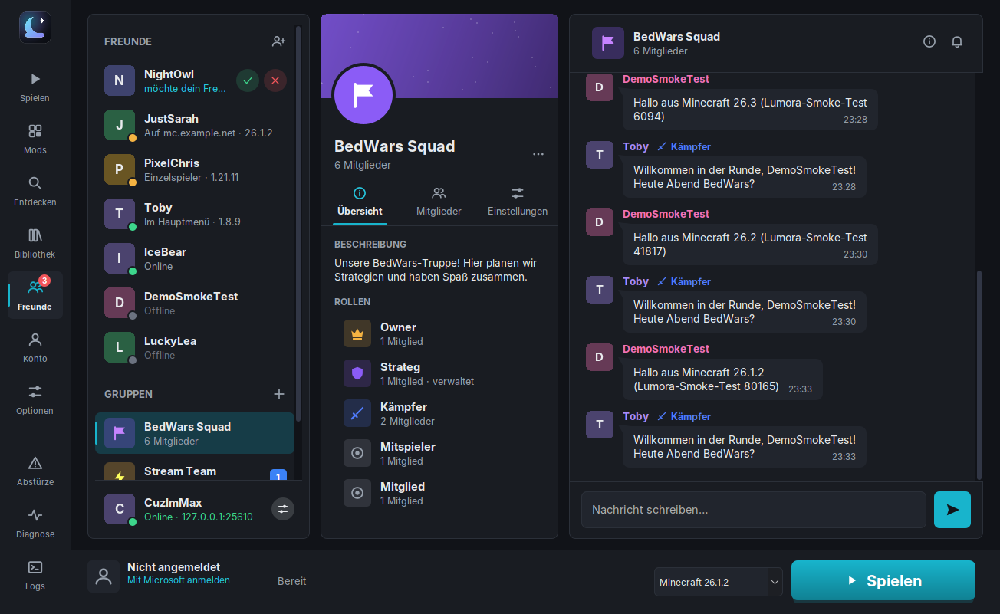

# Lumora Social: Freunde, Gruppen, Chat und das Lumora-Backend

Lumora Social verbindet Spieler, die Lumora nutzen: Freundesliste mit Live-Status, Freundschaftsanfragen, Gruppen mit
eigenen Rollen, Direkt- und Gruppenchat, Cosmetics und Emotes anderer Spieler und das Lumora-Badge. Es gibt die
Funktion im **Launcher** (Seite „Freunde“) und **im Spiel** (Taste **U**, „☻ Freunde“ im Hauptmenü und im ESC-Menü) in
allen 18 Versionen von 1.8.9 bis 26.3.



## 1. Der offizielle Lumora-Server

LabyMod hat für Freunde und Chat „LabyConnect“. Dafür gibt es keine offizielle Schnittstelle für andere Clients
(siehe [LABYCONNECT.md](LABYCONNECT.md)), und die Projektregeln verbieten Reverse Engineering und fremde Zugangsdaten.
Lumora hat deshalb ein **eigenes Backend** (`lumora-social-server`). Launcher und Spiel verbinden sich immer mit dem
**offiziellen Server** `wss://lumora.jardateien.de/` (`dev.lumora.social.Endpoint.OFFICIAL`). Eigene Server lassen
sich nicht mehr eintragen. Nur Tests und die Entwicklung setzen mit `-Dlumora.social.server=<adresse>` eine andere
Adresse.

## 2. Funktionen

| Bereich | Launcher | Im Spiel |
|---|---|---|
| Freunde | Liste mit Status (Online, Beschäftigt, Abwesend, Im Hauptmenü, Einzelspieler, „Auf mc.server.de“ mit Version, Offline), hinzufügen per Minecraft-Name, Anfragen annehmen/ablehnen/zurückziehen, entfernen, blockieren, „Server beitreten“ (Quick Play) | Liste mit Status, hinzufügen (+), Anfragen ✔/✖, entfernen |
| Gruppen | erstellen mit Name, Beschreibung, Symbol und Farbe; Banner; Tabs Übersicht / Mitglieder / Einstellungen | Liste, erstellen (+, Name), Infos (Beschreibung, Rollen, Mitglieder), Mitglied hinzufügen/entfernen, verlassen |
| Rollen | eigene Rollen (Name, Symbol, Farbe, „darf verwalten“), feste Rollen Owner und Mitglied, Rolle zuweisen, Gruppe übergeben | Anzeige (Symbol und Farbe neben dem Namen) |
| Chat | Direkt- und Gruppenchat, Tagestrenner, Rollen-Tags, Uhrzeit, ✓ zugestellt / ✓✓ gelesen, ältere Nachrichten beim Hochscrollen, fehlgeschlagene Nachrichten erneut senden; eigene Nachrichten bearbeiten und löschen, Suche (Protokoll) | gleich, Eingabefeld mit Einfügen (Strg+V) |
| Privatsphäre | Einstellungen unten links: Status (Online, Beschäftigt, Abwesend, Unsichtbar), wer Anfragen schicken darf (alle, Freunde von Freunden, niemand), blockierte Spieler, Server-Adresse für Freunde | Modul „Lumora Badge“: ob andere dein Badge sehen |
| Lumora-Badge | – | ein Lumora-Stern neben dem Namen anderer Lumora-Spieler, über dem Kopf und in der Tab-Liste (Modul „Lumora Badge“) |
| Benachrichtigungen | Zähler an „Freunde“ in der Navigation, Ungelesen-Zähler je Freund und Gruppe, stummschalten | Lumora-Hinweise für neue Nachrichten, Anfragen und Freunde, die online kommen; stummschalten |

Name, Symbol, Beschreibung und Rollen einer Gruppe bearbeitet man im Launcher. Im Spiel gibt es dafür einen Hinweis.

## 3. Anmeldung, Sicherheit und Privatsphäre

- **Keine Passwörter, keine eigenen Konten.** Lumora Social erkennt dich an deinem Minecraft-Konto, genau wie ein
  Minecraft-Server im Online-Modus: Der Server schickt eine zufällige Server-ID, dein Client meldet sie beim
  offiziellen Mojang-Sitzungsdienst an (`sessionserver.mojang.com/session/minecraft/join`), und der Server fragt bei
  Mojang nach (`hasJoined`). Dein Zugriffstoken geht **nur an Mojang**, nie an den Lumora-Server, und steht in keinem
  Log. Der Launcher erneuert ein abgelaufenes Token still über die gespeicherte (DPAPI-verschlüsselte) Sitzung. Das
  Spiel nutzt seine eigene Sitzung. Im Client steckt kein Geheimnis.
- **Verschlüsselung:** Der offizielle Server ist nur über `wss://` (TLS, Let's Encrypt) erreichbar. `ws://` ohne TLS
  akzeptieren Launcher und Spiel nur für diesen PC und das lokale Netz (Tests).
- **Was der Server speichert** (PostgreSQL): UUID und Name der Spieler, erstes und letztes Erscheinen, Freundschaften
  und Anfragen, Blockierungen, Einstellungen (Status, Anfragen, Badge), Gruppen mit Rollen, Lesepositionen, Nachrichten
  (bearbeitete mit Zeitpunkt, gelöschte ohne Text) und ein Protokoll sicherheitsrelevanter Aktionen (Anmeldung,
  Blockieren, Einstellungen). Nachrichten liegen **im Klartext** in der Datenbank: Lumora Social ist kein
  Ende-zu-Ende-verschlüsselter Messenger. Cosmetics, Emotes und Statuszeilen hält der Server nur, solange die
  Verbindung besteht.
- **Status:** Freunde sehen, ob du im Launcher, im Hauptmenü, im Einzelspieler oder auf einem Server bist, dazu
  „Beschäftigt“ oder „Abwesend“, wenn du das wählst. „Unsichtbar“ wendet der Server selbst an: Freunde sehen dich
  offline, dein echter Status verlässt den Server nicht. Die Server-Adresse sehen Freunde nur, solange „Server-Adresse
  für Freunde sichtbar“ an ist. Wer kein Freund ist, sieht keinen Status.
- **Anfragen und Blockieren:** Wer dir Anfragen schicken darf, stellst du ein (alle, Freunde von Freunden, niemand).
  Blockieren beendet eine Freundschaft und offene Anfragen in beide Richtungen. Der Blockierte sieht nur „nimmt keine
  Freundschaftsanfragen an“, aber keinen Hinweis auf die Blockierung. Zwischen blockierten Spielern gibt es keine
  Cosmetics, keine Emotes, keine Statuszeilen, keine Party-Einladungen und kein Badge.
- **Lumora-Badge:** Das Spiel fragt den Server, welche Spieler in der Tab-Liste und in der Nähe gerade mit Lumora
  spielen. Der Server antwortet nur mit Ja oder Nein und lässt Spieler aus, die ihr Badge ausgeschaltet haben oder die
  mit dem Fragenden blockiert sind. Nur Spieler, die gerade im Spiel sind, zählen (der Launcher allein nicht).
- **Eingaben** werden auf beiden Seiten bereinigt (Steuer- und Bidi-Zeichen, Minecraft-Formatcodes). Längen: Nachricht
  500 Zeichen, Gruppenname 32, Beschreibung 300, Rolle 20.
- **Grenzen gegen Missbrauch:** 12 Nachrichten in 10 Sekunden, 10 Freundschaftsanfragen pro Minute, 5 neue Gruppen in
  10 Minuten, 300 Freunde, 30 Gruppen pro Spieler, 100 Mitglieder und 12 Rollen pro Gruppe, 6 gleichzeitige
  Verbindungen pro Konto, 16 pro IP-Adresse (hinter dem Proxy aus `X-Real-IP`, nur von Loopback übernommen), 20
  Nachrichten pro Sekunde je Verbindung, 20 Badge-Abfragen pro Minute. Frames über 64 KiB werden abgelehnt.
- **Rechte in Gruppen:** Der Owner darf alles. Rollen mit „darf verwalten“ dürfen Mitglieder hinzufügen und entfernen
  (keine anderen verwaltenden) sowie Name und Beschreibung ändern. Hinzufügen kann man nur eigene Freunde. Verlässt
  der Owner die Gruppe, geht sie an das dienstälteste verwaltende Mitglied, sonst an das dienstälteste Mitglied.
- Direktnachrichten gehen nur an Freunde. Nach dem Entfernen bleibt der Verlauf lesbar.

## 4. Betrieb des offiziellen Servers

Der Server läuft auf Ubuntu 24.04 hinter nginx. Die Vorlagen liegen in [`packaging/server/`](../packaging/server):

| Datei | Zweck |
|---|---|
| `lumora-backend.service` | systemd-Dienst als Benutzer `lumora` (ohne Root), lauscht nur auf `127.0.0.1:25600`, `--behind-proxy`, Härtung (`ProtectSystem=strict` u. a.) |
| `nginx-lumora.conf` | TLS-Endpunkt `lumora.jardateien.de`, WebSocket-Weiterleitung, `/health` |
| `lumora-backup.sh`, `.service`, `.timer` | tägliches `pg_dump` um 04:00, 14 Tage aufbewahrt in `/opt/lumora/backups` |

Datenbankzugang nur über Umgebungsvariablen aus `/opt/lumora/config/backend.env` (Rechte 600, Besitzer root):
`LUMORA_DB_URL` (`jdbc:postgresql://127.0.0.1:5432/lumora`), `LUMORA_DB_USER`, `LUMORA_DB_PASSWORD`. Das Passwort
wird auf dem Server erzeugt und steht nirgends im Quellcode. PostgreSQL lauscht nur lokal. Offene Ports: 22, 80
(Let's-Encrypt-Erneuerung, Weiterleitung auf HTTPS) und 443.

```
java -jar lumora-social-server.jar [--port 25600] [--bind 0.0.0.0] [--data ./lumora-social-data]
                                   [--tls-keystore server.p12] [--behind-proxy] [--import <ordner>]
```

| Option | Bedeutung |
|---|---|
| `--port` | TCP-Port, Standard 25600 |
| `--bind` | Adresse, auf der der Server lauscht. Hinter dem Reverse-Proxy: `127.0.0.1` |
| `--behind-proxy` | Client-Adresse aus `X-Real-IP`, nur bei Verbindungen von Loopback (für die Grenze pro IP) |
| `--data` | Datenordner, nur ohne Datenbank (Dateispeicher für Tests und Entwicklung) |
| `--import` | kopiert einen alten Datenordner einmalig in eine leere Datenbank |
| `--tls-keystore` | PKCS12-Keystore für `wss://` direkt im Server; Passwort in `LUMORA_SOCIAL_TLS_PASSWORD` |
| `--dev-auth` | **Nur zum Testen**: keine Mojang-Prüfung. Startet nur zusammen mit `--bind 127.0.0.1` |

Das Datenbankschema entsteht beim Start aus `db/V*.sql` (Tabelle `schema_version`), spätere Änderungen kommen als neue
Migrationsdateien dazu. `GET /health` antwortet mit `ok`.

## 5. Technik

- Client (`lumora-social`, im Launcher und gebündelt in jeder Lumora-Mod): WebSocket über `java.net.http`, keine
  zusätzliche Bibliothek. Automatisches Neuverbinden (2 s bis 60 s), Nachrichten bleiben während einer Trennung
  „ausstehend“ und werden danach gesendet. Der Server erkennt Doppelungen an einer Nonce.
- Server (`lumora-social-server`): eigener schlanker WebSocket-Server (RFC 6455, nur Text), ein virtueller Thread pro
  Verbindung, Zustand im Speicher. Gespeichert wird einmal pro Sekunde und nur, was sich geändert hat:
  `PgStore` vergleicht mit dem zuletzt geschriebenen Stand und schreibt die geänderten Zeilen in einer Transaktion
  (Treiber `org.postgresql:postgresql`); ohne Datenbank schreibt `FileStore` atomar in Dateien.
- Die Spielansicht ist versionsunabhängig (`lumora-core`, `dev.lumora.core.social.SocialView`). Sie zeichnet mit der
  `HudGraphics`-Schicht der Lumora-API. Pro Minecraft-Version gibt es nur einen kleinen Adapter
  (`client/mc<version>/…/gui/SocialScreen.java`).
- Lumora-Badge (`dev.lumora.core.social.LumoraBadgeModule`): Namensschild-Dekorator der Lumora-API mit der Bitmap-Schrift
  `lumora:badge` (auf 1.8.9 und 1.12.2 das Zeichen ✦). Eine Abfrage `lumora.who` für bis zu 256 Spieler (die nahen zuerst),
  höchstens alle 5 s bei Änderungen der Liste, sonst alle 30 s; nahe Spieler kommen zusätzlich als `recognized`-Push über
  `cosmetics.watch`. Beim Zeichnen nur ein Nachschlagen in einer Menge.
- Geteilte Statuszeilen (seit Lumora-API 1.13, z. B. der Song des Spotify-Addons unter dem Namen): `status.set` legt je
  Addon eine Zeile mit Sichtbarkeit `all`, `friends` oder `none` ab, nur solange die Verbindung besteht (nichts wird
  gespeichert); `status.get` fragt bis zu 100 Spieler auf einmal ab und bekommt nur die Zeilen, die der Fragende sehen
  darf. Höchstens 96 Zeichen, Formatierungscodes werden entfernt, 30 Änderungen und 120 Abfragen pro Minute.
- Skins: Die Köpfe kommen aus dem offiziellen Mojang-Profil (`sessionserver.mojang.com` → `textures.minecraft.net`),
  dabei wird nur die öffentliche UUID gesendet. Im Spiel werden die 8×8 Pixel als Rechtecke gezeichnet, ohne Textur-API.

Protokoll (JSON-Textnachrichten, Feld `op`; Anfragen mit `rid` werden mit `ok`/`error` beantwortet):

| Richtung | Nachrichten |
|---|---|
| Anmeldung | `hello` (Protokoll, Profil) → `challenge` (Server-ID) → `login` → `welcome` (Freunde, Anfragen, Gruppen, Unterhaltungen, Einstellungen, Blockierte) oder `rejected` |
| Client → Server | `presence`, `status.set`, `status.get`, `cosmetics.set`, `cosmetics.watch` (Antwort auch mit `lumora`), `lumora.who`, `emote.play`, `emote.stop`, `friend.request/accept/decline/remove`, `block`, `unblock`, `settings.set`, `group.create/update/delete/add/kick/leave`, `group.role.save/delete`, `group.member.role`, `conv.mute`, `msg.send/history/read/edit/delete/search` |
| Server → Client | `friends`, `requests`, `presence`, `settings`, `cosmetics`, `emote`, `recognized`, `group`, `group.removed`, `conv` (Ungelesen, Lesestand), `msg`, `msg.update`, `history`, `notice` |

## 6. Tests

- `lumora-social`: Textbereinigung, Adressen (TLS-Pflicht außerhalb des LAN), Konversations-IDs, JSON-Rundreise.
- `lumora-social-server`: echter Server und echte Clients über WebSocket, jeder Test zweimal: mit Dateispeicher und
  mit echtem PostgreSQL (`SocialServerPgTest`, eingebettetes PostgreSQL 17). Freunde, Status, Direktnachrichten mit
  Lesebestätigung, Gruppen, Rollen und Rechte, 60 Nachrichten mit Nachladen, Stummschalten, Owner-Übergabe,
  Privatsphäre (Anfragen-Regel, Blockieren, Status-Modi, Unsichtbar), Nachrichten bearbeiten/löschen/suchen,
  Lumora-Badge (Push, Abfrage, Einstellung, Blockieren), Neustart mit gespeicherten Daten, gleiches Konto in Launcher
  und Spiel, geteilte Statuszeilen je Sichtbarkeit, `/health`, Müll-Anfragen, `--dev-auth` nur auf Loopback,
  `X-Real-IP` nur als IP-Literal.
- Im Spiel: `.t/social-smoke.sh` startet einen Testserver mit Bots. Der Smoke-Test jeder Version schickt eine
  Freundschaftsanfrage, öffnet den Gruppenchat, sendet eine Nachricht und prüft Zustellung und Antwort
  (Ergebnis `social` im Smoke-Bericht).

## 7. Grenzen

- Keine Ende-zu-Ende-Verschlüsselung (siehe oben). Kein Dateiversand, keine Sprachkanäle (dafür LabyVoice).
- Rollen und Gruppendetails bearbeitet man im Launcher, im Spiel nur ansehen.
- Ohne Mojang-Konto (z. B. Demo-Modus) keine Anmeldung, außer bei einem Testserver mit `--dev-auth`.
