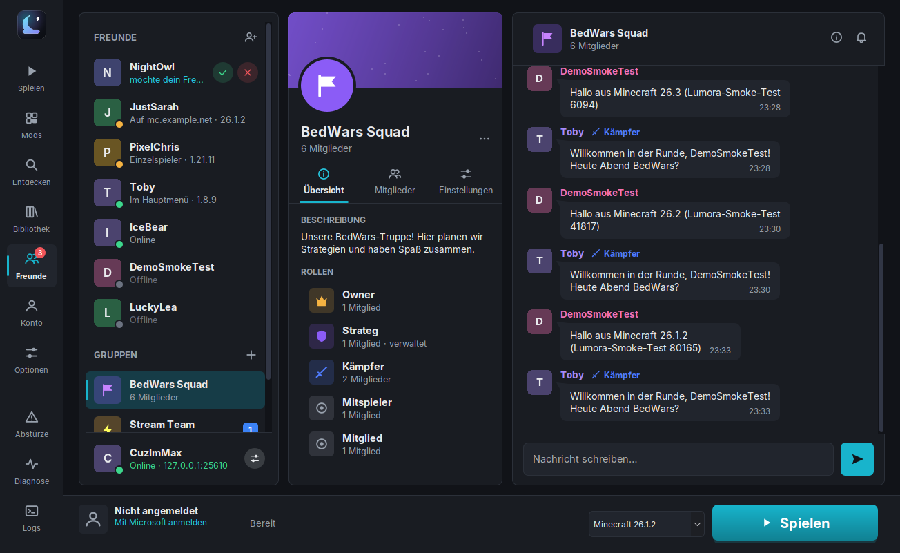

# Lumora Social: Freunde, Gruppen und Chat

Lumora Social verbindet Spieler, die Lumora nutzen: Freundesliste mit Live-Status, Freundschaftsanfragen, Gruppen mit
eigenen Rollen und Direkt- und Gruppenchat. Es gibt die Funktion im **Launcher** (Seite „Freunde“) und **im Spiel**
(Taste **U**, „☻ Freunde“ im Hauptmenü und im ESC-Menü) in allen 18 Versionen von 1.8.9 bis 26.3.



## 1. Warum ein eigener Server?

LabyMod hat für Freunde und Chat „LabyConnect“. Dafür gibt es keine offizielle Schnittstelle für andere Clients
(siehe [LABYCONNECT.md](LABYCONNECT.md)), und die Projektregeln verbieten Reverse Engineering und fremde Zugangsdaten.
Lumora bringt deshalb einen **eigenen, kleinen Server** mit, den du selbst oder jemand aus deiner Runde betreibt
(`lumora-social-server.jar`). Es gibt **keinen voreingestellten Server**: Der Launcher fragt beim ersten Öffnen der
Seite „Freunde“ nach der Adresse.

## 2. Funktionen

| Bereich | Launcher | Im Spiel |
|---|---|---|
| Freunde | Liste mit Status (Online, Im Hauptmenü, Einzelspieler, „Auf mc.server.de“ mit Version, Offline), hinzufügen per Minecraft-Name, Anfragen annehmen/ablehnen/zurückziehen, entfernen, „Server beitreten“ (Quick Play) | Liste mit Status, hinzufügen (+), Anfragen ✔/✖, entfernen |
| Gruppen | erstellen mit Name, Beschreibung, Symbol und Farbe; Banner; Tabs Übersicht / Mitglieder / Einstellungen | Liste, erstellen (+, Name), Infos (Beschreibung, Rollen, Mitglieder), Mitglied hinzufügen/entfernen, verlassen |
| Rollen | eigene Rollen (Name, Symbol, Farbe, „darf verwalten“), feste Rollen Owner und Mitglied, Rolle zuweisen, Gruppe übergeben | Anzeige (Symbol und Farbe neben dem Namen) |
| Chat | Direkt- und Gruppenchat, Tagestrenner, Rollen-Tags, Uhrzeit, ✓ zugestellt / ✓✓ gelesen, ältere Nachrichten beim Hochscrollen, fehlgeschlagene Nachrichten erneut senden | gleich, Eingabefeld mit Einfügen (Strg+V) |
| Benachrichtigungen | Zähler an „Freunde“ in der Navigation, Ungelesen-Zähler je Freund und Gruppe, stummschalten | Lumora-Hinweise für neue Nachrichten, Anfragen und Freunde, die online kommen; stummschalten |

Name, Symbol, Beschreibung und Rollen einer Gruppe bearbeitet man im Launcher. Im Spiel gibt es dafür einen Hinweis.

## 3. Anmeldung und Sicherheit

- **Keine Passwörter, keine eigenen Konten.** Lumora Social erkennt dich an deinem Minecraft-Konto, genau wie ein
  Minecraft-Server im Online-Modus: Der Server schickt eine zufällige Server-ID, dein Client meldet sie beim
  offiziellen Mojang-Sitzungsdienst an (`sessionserver.mojang.com/session/minecraft/join`), und der Server fragt bei
  Mojang nach (`hasJoined`). Dein Zugriffstoken geht **nur an Mojang**, nie an den Lumora-Server, und steht in keinem
  Log. Der Launcher erneuert ein abgelaufenes Token still über die gespeicherte (DPAPI-verschlüsselte) Sitzung. Das
  Spiel nutzt seine eigene Sitzung. Der Launcher übergibt dem Spiel nur die Server-Adresse.
- **Verschlüsselung:** `ws://` (ohne TLS) akzeptieren Launcher und Spiel nur für diesen PC und das lokale Netz
  (Loopback, 10.x, 172.16–31.x, 192.168.x, `.local`/`.lan`, Namen ohne Punkt). Im Internet ist `wss://` Pflicht,
  sonst wären Nachrichten und die Verbindung unterwegs lesbar.
- **Was der Server speichert:** UUID und Name der Spieler, Freundschaften und Anfragen, Gruppen mit Rollen,
  Lesepositionen und die letzten 1000 Nachrichten je Unterhaltung, **im Klartext** im Datenordner. **Wer den Server
  betreibt, kann die Nachrichten lesen.** Lumora Social ist ein Chat unter Leuten, die sich vertrauen, kein
  Ende-zu-Ende-verschlüsselter Messenger.
- **Status und Server-Adresse:** Freunde sehen, ob du im Launcher, im Hauptmenü, im Einzelspieler oder auf einem Server
  bist. Die Server-Adresse sehen sie nur, solange „Server-Adresse für Freunde sichtbar“ an ist (Launcher → Freunde →
  Einstellungen unten links). Wer kein Freund ist, sieht keinen Status.
- **Eingaben** werden auf beiden Seiten bereinigt (Steuer- und Bidi-Zeichen, Minecraft-Formatcodes). Längen: Nachricht
  500 Zeichen, Gruppenname 32, Beschreibung 300, Rolle 20.
- **Grenzen gegen Missbrauch:** 12 Nachrichten in 10 Sekunden, 10 Freundschaftsanfragen pro Minute, 5 neue Gruppen in
  10 Minuten, 300 Freunde, 30 Gruppen pro Spieler, 100 Mitglieder und 12 Rollen pro Gruppe, 6 gleichzeitige
  Verbindungen pro Konto, 16 pro IP-Adresse, 20 Nachrichten pro Sekunde je Verbindung. Frames über 64 KiB werden
  abgelehnt.
- **Rechte in Gruppen:** Der Owner darf alles. Rollen mit „darf verwalten“ dürfen Mitglieder hinzufügen und entfernen
  (keine anderen verwaltenden) sowie Name und Beschreibung ändern. Hinzufügen kann man nur eigene Freunde. Verlässt
  der Owner die Gruppe, geht sie an das dienstälteste verwaltende Mitglied, sonst an das dienstälteste Mitglied.
- Direktnachrichten gehen nur an Freunde. Nach dem Entfernen bleibt der Verlauf lesbar.

## 4. Server betreiben

Voraussetzung: Java 21 oder neuer. Die Datei liegt im Release-Ordner (`lumora-social-server.jar`) bzw. nach dem Bauen
unter `lumora-social-server/build/libs/`.

```
java -jar lumora-social-server.jar [--port 25600] [--bind 0.0.0.0] [--data ./lumora-social-data]
                                   [--tls-keystore server.p12]
```

| Option | Bedeutung |
|---|---|
| `--port` | TCP-Port, Standard 25600 |
| `--bind` | Adresse, auf der der Server lauscht. Standard alle (`0.0.0.0`). Hinter einem Reverse-Proxy: `127.0.0.1` |
| `--data` | Datenordner (`state.json`, `messages/*.jsonl`). Für ein Backup diesen Ordner kopieren |
| `--tls-keystore` | PKCS12-Keystore mit Zertifikat und Schlüssel für `wss://` direkt im Server; Passwort in der Umgebungsvariable `LUMORA_SOCIAL_TLS_PASSWORD` |
| `--dev-auth` | **Nur zum Testen**: keine Mojang-Prüfung. Startet nur zusammen mit `--bind 127.0.0.1` |

`GET /health` antwortet mit `ok` (für Monitoring oder Proxy-Checks).

### Im lokalen Netz (LAN-Party, WG)

1. Auf einem PC: `java -jar lumora-social-server.jar` (Windows-Firewall: Port 25600 für private Netzwerke freigeben).
2. In jedem Launcher unter **Freunde** die IP dieses PCs eintragen, z. B. `192.168.0.10`.

### Im Internet (empfohlen: Reverse-Proxy mit Let's Encrypt)

Auf einem Server mit Domain, z. B. `chat.example.de`, mit [Caddy](https://caddyserver.com) (holt das Zertifikat selbst):

```
# Caddyfile
chat.example.de {
    reverse_proxy 127.0.0.1:25600
}
```

```
java -jar lumora-social-server.jar --bind 127.0.0.1 --data /var/lib/lumora-social
```

Im Launcher reicht dann die Adresse `chat.example.de` (wird zu `wss://chat.example.de:443/`). Mit nginx funktioniert es
genauso (`proxy_http_version 1.1`, `Upgrade`- und `Connection`-Header weiterreichen, `proxy_read_timeout` über 120 s).

Beispiel systemd-Dienst (`/etc/systemd/system/lumora-social.service`):

```
[Unit]
Description=Lumora Social
After=network-online.target

[Service]
User=lumora
ExecStart=/usr/bin/java -jar /opt/lumora/lumora-social-server.jar --bind 127.0.0.1 --data /var/lib/lumora-social
Restart=on-failure

[Install]
WantedBy=multi-user.target
```

### Ohne Proxy, mit eigenem Zertifikat

```
openssl pkcs12 -export -in fullchain.pem -inkey privkey.pem -out server.p12
set LUMORA_SOCIAL_TLS_PASSWORD=…
java -jar lumora-social-server.jar --tls-keystore server.p12 --port 443
```

## 5. Technik

- Client (`lumora-social`, im Launcher und gebündelt in jeder Lumora-Mod): WebSocket über `java.net.http`, keine
  zusätzliche Bibliothek. Automatisches Neuverbinden (2 s bis 60 s), Nachrichten bleiben während einer Trennung
  „ausstehend“ und werden danach gesendet. Der Server erkennt Doppelungen an einer Nonce.
- Server (`lumora-social-server`): eigener schlanker WebSocket-Server (RFC 6455, nur Text), ein virtueller Thread pro
  Verbindung, Zustand im Speicher, atomar geschriebene Dateien.
- Die Spielansicht ist versionsunabhängig (`lumora-core`, `dev.lumora.core.social.SocialView`). Sie zeichnet mit der
  `HudGraphics`-Schicht der Lumora-API. Pro Minecraft-Version gibt es nur einen kleinen Adapter
  (`client/mc<version>/…/gui/SocialScreen.java`).
- Skins: Die Köpfe kommen aus dem offiziellen Mojang-Profil (`sessionserver.mojang.com` → `textures.minecraft.net`),
  dabei wird nur die öffentliche UUID gesendet. Im Spiel werden die 8×8 Pixel als Rechtecke gezeichnet, ohne Textur-API.

Protokoll (JSON-Textnachrichten, Feld `op`; Anfragen mit `rid` werden mit `ok`/`error` beantwortet):

| Richtung | Nachrichten |
|---|---|
| Anmeldung | `hello` (Protokoll, Profil) → `challenge` (Server-ID) → `login` → `welcome` (Freunde, Anfragen, Gruppen, Unterhaltungen) oder `rejected` |
| Client → Server | `presence`, `friend.request/accept/decline/remove`, `group.create/update/delete/add/kick/leave`, `group.role.save/delete`, `group.member.role`, `conv.mute`, `msg.send/history/read` |
| Server → Client | `friends`, `requests`, `presence`, `group`, `group.removed`, `conv` (Ungelesen, Lesestand), `msg`, `history`, `notice` |

## 6. Tests

- `lumora-social`: Textbereinigung, Adressen (TLS-Pflicht außerhalb des LAN), Konversations-IDs, JSON-Rundreise.
- `lumora-social-server`: echter Server und echte Clients über WebSocket. Freunde, Status, Direktnachrichten mit
  Lesebestätigung, Gruppen, Rollen und Rechte, 60 Nachrichten mit Nachladen, Stummschalten, Owner-Übergabe,
  Neustart mit gespeicherten Daten, gleiches Konto in Launcher und Spiel, `/health`, Müll-Anfragen,
  `--dev-auth` nur auf Loopback.
- Im Spiel: `.t/social-smoke.sh` startet einen Testserver mit Bots. Der Smoke-Test jeder Version schickt eine
  Freundschaftsanfrage, öffnet den Gruppenchat, sendet eine Nachricht und prüft Zustellung und Antwort
  (Ergebnis `social` im Smoke-Bericht).

## 7. Grenzen

- Keine Ende-zu-Ende-Verschlüsselung (siehe oben). Kein Dateiversand, keine Sprachkanäle (dafür LabyVoice).
- Pro Server ein Netz von Freunden; Server untereinander sind nicht verbunden.
- Rollen und Gruppendetails bearbeitet man im Launcher, im Spiel nur ansehen.
- Ohne Mojang-Konto (z. B. Demo-Modus) keine Anmeldung, außer bei einem Testserver mit `--dev-auth`.
